# Student Management — DevSecOps Pipeline

A Spring Boot REST API for managing students, departments and enrollments, delivered through a complete **DevSecOps CI/CD pipeline**: security is built into every phase, from the developer's commit to production monitoring.

> Project for the module **Labs: Cybersecurity and Coding** (ESPRIT, 5th year NIDS, 2026/2027). It extends the DevOps pipeline built in 4th year into a full DevSecOps chain covering the four phases of the course: Development, Acceptance, Production and Operations.

---

## The pipeline

```mermaid
flowchart LR
    subgraph DEV["1 · Development"]
        A[Pre-commit hook<br/>Gitleaks] --> B[Checkout] --> C[Secrets scan<br/>Gitleaks] --> D[SAST<br/>SonarQube] --> E[Build<br/>Maven] --> F[Docker image] --> G[SCA + container scan<br/>Trivy]
    end
    subgraph ACC["2 · Acceptance"]
        I[Deploy<br/>Kubernetes] --> J[Verification] --> K[Network scan<br/>Nmap]
    end
    subgraph PROD["3 · Production"]
        L[Security smoke test<br/>OWASP ZAP Baseline]
    end
    subgraph OPS["4 · Operations"]
        M[Monitoring<br/>Prometheus + Grafana] --> N[Security report<br/>by email]
    end
    G --> H[Push<br/>Docker Hub] --> I
    K --> L --> M
```



| Phase | Practice | Tool | Behaviour |
|---|---|---|---|
| **Development** | Pre-commit hook, secret detection | **Gitleaks** | Blocks a commit containing a secret, locally and again in CI (full Git history) |
| | Static analysis (SAST) | **SonarQube** | Analyses the source code **before** the build |
| | Dependency management (SCA) + container security | **Trivy** | Scans libraries and OS packages of the image; **blocks** on fixable CRITICAL vulnerabilities, before the image is published |
| **Acceptance** | Security scanning | **Nmap** | Probes the deployed app; **blocks** if a port outside the allowlist is exposed |
| **Production** | Security smoke test (DAST) | **OWASP ZAP Baseline** | Crawls the running app and checks every response (headers, information leaks…) |
| | Secrets management | **Kubernetes Secrets + Jenkins credentials** | No credentials in the code or the manifests |
| **Operations** | Continuous monitoring | **Prometheus + Grafana** | Cluster and application metrics (`/actuator/prometheus`) |
| | Reporting | **HTML security report** | One readable report per build, emailed and archived with all raw results |

## Why these tools

- **Gitleaks** (instead of Talisman / git-hound): one tool for both the local hook and the CI scan, scans the whole history, actively maintained.
- **SonarQube**: the same rules engine as SonarLint, enforced centrally in the pipeline.
- **Trivy** (instead of Clair / Anchore / OWASP Dependency-Check): one tool for SCA and container images, no server or API key needed, fast vulnerability database.
- **Nmap**: named by the course for detecting unexpected open ports; used here as an exposure gate.
- **OWASP ZAP Baseline**: the security smoke test recommended for the Production phase; passive, safe to run on every deployment.
- **Prometheus + Grafana**: the continuous monitoring stack already running in the cluster.

## Security findings and fixes

| Finding | Detected by | Fix |
|---|---|---|
| Database password hardcoded in a Kubernetes manifest | Manual review before committing the manifests | Moved to a Kubernetes Secret; `k8s/secret-*.yaml` excluded by `.gitignore` |
| 9 critical vulnerabilities in the image | Trivy (pipeline blocked) | Alpine packages patched at build time (`apk upgrade`); Tomcat upgraded 10.1.44 → 10.1.61 |
| 2 Spring Framework CVEs fixed only in Spring 7 | Trivy | Documented risk acceptance in `.trivyignore` with an expiry date: the app uses neither XSLT views nor Server-Sent Events |
| Container running as root | Review | Dedicated non-root user in the `Dockerfile` |
| Internal endpoints exposed | Review | Only `health` and `prometheus` actuator endpoints are exposed |
| Missing HTTP security headers, vulnerable Swagger UI bundle | Nmap + ZAP | Documented; planned improvement |

## Repository structure

```
├── src/                         Spring Boot application (Java 21)
├── k8s/                         Kubernetes manifests (app, MySQL, storage, ServiceMonitor)
├── security/generate_report.py  Builds the readable HTML security report from all scan results
├── Jenkinsfile                  The DevSecOps pipeline
├── Dockerfile                   Hardened image (patched packages, non-root user)
├── .pre-commit-config.yaml      Local Gitleaks hook
├── .trivyignore                 Documented, time-limited risk acceptances
└── pom.xml                      Maven build (Tomcat version pinned for security)
```

## Running it

**Infrastructure:** one Ubuntu 22.04 VM (Vagrant + VirtualBox) hosting Jenkins, SonarQube, Docker and a Minikube cluster.

1. **Create the database Secret** (never committed):
   ```bash
   kubectl create namespace devops
   kubectl create secret generic spring-app-secret -n devops \
     --from-literal=SPRING_DATASOURCE_URL='jdbc:mysql://mysql-service:3306/studentdb?createDatabaseIfNotExist=true' \
     --from-literal=SPRING_DATASOURCE_USERNAME=root \
     --from-literal=SPRING_DATASOURCE_PASSWORD='<choose-a-password>'
   ```
2. **Deploy:** `kubectl apply -f k8s/`
3. **Enable the pre-commit hook** in your clone: `pre-commit install`
4. **Run the pipeline** in Jenkins (credentials needed: `github-credentials`, `dockerhub-credentials`, `sonar-token`).

**API documentation:** `http://<node-ip>:30080/student/swagger-ui/index.html`

## Reports produced by each build

Archived in Jenkins and emailed after every run:

- `security-report.html`: readable summary of all checks
- `gitleaks-report.json` · `trivy-report.json` · `nmap-app-report.xml` · `nmap-nodeports.gnmap` · `zap-report.html`

## Authors

Oussema Neffati — ESPRIT
